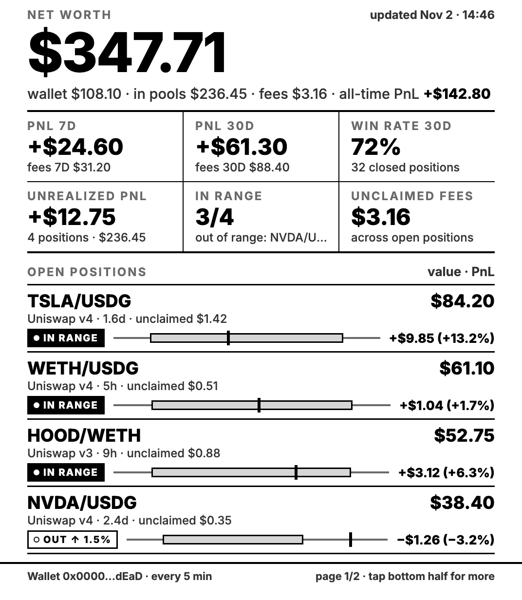
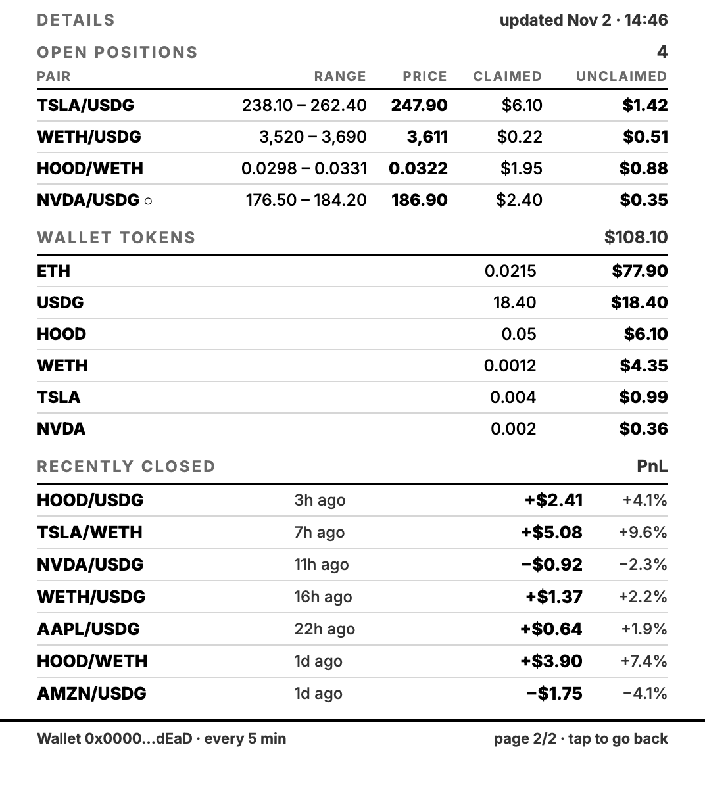

# Kindle LP Agent Dashboard

Turn an old jailbroken Kindle into an always-on e-ink dashboard for your
[LP Agent](https://lpagent.io) liquidity positions.

Everything runs on the Kindle itself, with no server: a small shell daemon pulls the LP Agent
Open API every 5 minutes and a local web app draws it.

<table><tr>
<td></td>
<td></td>
</tr></table>

<sub>Screenshots use the fake data in <code>demo/</code>.</sub>

## What it shows

- **Page 1** has these parts:
  - **Net worth**: wallet + open positions + unclaimed fees, the same total the LP Agent app shows.
  - **Six tiles**: PnL 7D and 30D, win rate 30D, unrealized PnL, positions in range, unclaimed fees.
  - **Open positions**: an IN RANGE / OUT badge and a small range bar for each one.
- **Page 2** (tap the bottom half of page 1) shows a range / price / claimed / unclaimed table, your wallet tokens and recently closed positions. Any tap goes back, and the dashboard also returns to page 1 after 2 idle minutes.
- **Always on**:
  - Data refreshes every 5 minutes, and a banner warns you when the data is stale.
  - A full flashing refresh runs every hour to clear e-ink ghosting.
  - The frontlight is turned off.
  - The screensaver is kept away, and the dashboard comes back by itself after a reboot.

Supported chains:
- `ROBINHOOD`, with amounts in USD.
- `SOL`, with amounts in SOL.

## Requirements

- **A jailbroken Kindle.** It was built and tested on a **Kindle Paperwhite 4** (10th gen, firmware 5.16.3.1) jailbroken with
  **WinterBreak** (see the [Kindle Modding guide](https://kindlemodding.org)). The layout is designed for
  1072x1448 and zooms to fit other screens. Other models are untested.
- **What the jailbreak must provide.** The current WinterBreak install sets up all of these:
  - scriptlets (`.sh` files in `documents/` that show up as books);
  - `/etc/upstart/kmc.conf`, which runs `/mnt/us/emergency.sh` at boot (needed for autostart);
  - optionally, `fbink` at `/mnt/us/libkh/bin/fbink` (for the ghosting flash).
- **An LP Agent Open API key** and the wallet address you want to show.
- **Wi-Fi.**

> Jailbreaking is at your own risk. It can brick the device and voids the warranty. Keep the Kindle in
> airplane mode until it is jailbroken, because an automatic firmware update can close the exploit.

## Install

1. **Copy the files.** Plug the Kindle into your computer and copy everything inside `kindle/` to the root of the
   Kindle drive, so you end up with `apps/`, `lpdash/`, `documents/` and `emergency.sh` on the device.
   - On macOS, use `cp -X` or delete the `._*` files afterwards.
   - If you already have an `emergency.sh` from something else, merge the two instead of overwriting yours.
2. **Configure it.** On the Kindle drive, copy `lpdash/config.example.sh` to `lpdash/config.sh` and fill it in.
3. **Start it.** Eject the Kindle, turn Wi-Fi on, open the Library and tap **LP Agent Dashboard**.
   - The first run registers the app, starts the daemon and opens the dashboard.
   - Data shows up within about 30 seconds.

### The "books" (scriptlets)

| Item in the Library | What it does |
|---|---|
| LP Agent Dashboard | Starts the daemon and opens the dashboard. Registers the app if it is missing. |
| LP Agent - Stop dashboard | Stops the daemon and turns the normal screensaver back on. |
| LP Agent - Dev shell (on/off) | Root telnet shell on port 2323, only for `DEV_SHELL_ALLOW_IP` (see [Development](#development)). |
| LP Agent - Diag | Writes system info to `lpdash/diag.txt` for debugging. |

## Configuration

`/mnt/us/lpdash/config.sh`, see [`config.example.sh`](kindle/lpdash/config.example.sh):

| Variable | Meaning |
|---|---|
| `LPA_KEY` | LP Agent Open API key |
| `LPA_OWNER` | Wallet to show |
| `LPA_CHAIN` | `ROBINHOOD` (USD) or `SOL` (SOL) |
| `INTERVAL` | Seconds between refreshes (default 300; the API is rate limited) |
| `FLASH_EVERY` | Full flashing refresh every N refreshes (default 12, about once an hour) |
| `TZ_OFFSET_MIN` | Your UTC offset in minutes for the on-screen clock (e.g. `420` for UTC+7) |
| `FRONTLIGHT` | Frontlight level set when the daemon starts (`0` = off, empty = leave it alone) |
| `DEV_SHELL_ALLOW_IP` | LAN IP of your computer for the dev shell (empty = dev shell disabled) |

## How it works

```
LP Agent Open API ──curl, every INTERVAL──> lpdash/lpdashd.sh ──> lpdash/data/*.js  (window.LPRAW = ...)
                                                                        │
                                              loaded with <script> tags │ (file:// has no XHR)
                                                                        ▼
        lipc appmgrd ──> /usr/bin/mesquite (WAF app com.lpagent.dashboard) ──> apps/xyz.lpagent.dashboard/index.html
```

- **Daemon** (`kindle/lpdash/lpdashd.sh`, busybox sh, runs as root):
  - Calls `/lp-positions/opening`, `/lp-positions/overview`, `/lp-positions/historical` and `/token/balance`, 6 s apart because of the rate limit, and retries on 429.
  - Once a minute it sets `preventScreenSaver`. If the screensaver is showing anyway, it wakes the Kindle and unloads the
    Special Offers "Swipe to unlock" screen.
- **App**: a WAF ("web app framework") app registered in `/var/local/appreg.db` (`lpdash/register_waf.sql`).
  - The Kindle browser is an old WebKit, so the page uses ES5, tables and absolute positioning only (no flexbox, no Promise).
  - It is drawn at 1072x1448 and zoomed to fit.
  - The Kindle's top system bar can't be hidden, so the page sets its title instead.
- **Autostart**: the jailbreak's `/etc/upstart/kmc.conf` runs `/mnt/us/emergency.sh` at boot, which starts
  `lpdash/autostart.sh`. That script waits for the UI and Wi-Fi, then starts the daemon and the app.
  - If the Kindle boots 3 times within 15 minutes, `lpdash/autostart.off` is created and autostart stops.
  - Create that file yourself to turn autostart off.

## Development

**Preview on your computer.** This uses headless Chrome and writes screenshots of both pages to `out/`:

```sh
tools/render-test.sh demo        # fake data from kindle/apps/xyz.lpagent.dashboard/demo/
```

To preview real data, fetch it once on your computer and render it. The `lipc` calls fail quietly off-device, which is fine.

```sh
cp kindle/lpdash/config.example.sh kindle/lpdash/config.sh    # fill it in (gitignored)
LPDASH_DIR=$PWD/kindle/lpdash ONESHOT=1 sh kindle/lpdash/lpdashd.sh
tools/render-test.sh
```

**Work on the device over Wi-Fi.**

1. Set `DEV_SHELL_ALLOW_IP` to your computer's LAN IP.
2. Tap **LP Agent - Dev shell (on/off)**. It prints the Kindle's IP.
3. Use these from your computer:

```sh
export KINDLE_IP=192.168.1.50                       # whatever the scriptlet printed
tools/ksh.py 'tail -20 /mnt/us/lpdash/log.txt'      # run a command
tools/ksh.py --put kindle/apps/xyz.lpagent.dashboard/index.html /mnt/us/apps/xyz.lpagent.dashboard/index.html
tools/kshot.py shot.png                             # screenshot of the e-ink framebuffer
```

To update the daemon, stop it first, then copy the file, then start it again. Editing a shell script while it runs is unsafe.

```sh
tools/ksh.py 'kill $(cat /mnt/us/lpdash/lpdashd.pid)'
tools/ksh.py --put kindle/lpdash/lpdashd.sh /mnt/us/lpdash/lpdashd.sh
tools/ksh.py 'nohup sh /mnt/us/lpdash/lpdashd.sh >/dev/null 2>&1 &'
```

Tap the Dev shell item again to turn the shell off when you are done.

## Troubleshooting

| Symptom | What to check |
|---|---|
| "No data yet" | The daemon is not running or `config.sh` is missing. Tap **LP Agent Dashboard** and look at `lpdash/log.txt`. |
| STALE DATA banner | Wi-Fi is off or the API is failing. `log.txt` shows the HTTP codes. If you see `429`, raise `INTERVAL`. |
| Tapping the book shows a message, then goes back Home | The app opens about 4 s after the scriptlet exits, so wait a moment. If it never opens, check that `com.lpagent.dashboard` is in `/var/local/appreg.db` (`handlerIds` table). |
| Net worth differs from the app by a few cents | Prices move between the two fetches. |
| The Kindle restarted by itself | Run `dmesg \| grep -i "reboot reason"` from the dev shell. `PWRON_LONGPRESS` means the power button was held for about 9 s. |
| Can't reach the dev shell | The IP may have changed after a reboot (DHCP), and a reboot also turns the shell off. Tap the item again: it prints the IP. |

**Uninstall:**

1. Tap **Stop dashboard**.
2. From the dev shell, run `sqlite3 /var/local/appreg.db < /mnt/us/lpdash/unregister_waf.sql`.
3. Delete `apps/xyz.lpagent.dashboard/`, `lpdash/`, the `LP Agent*.sh` files in `documents/`, and `emergency.sh`.

## Security notes

- **Your API key is stored in plain text** in `/mnt/us/lpdash/config.sh`. Anyone who plugs the Kindle into a computer
  can read it. Use a key you can revoke.
- **The dev shell is passwordless root over telnet.** It only accepts `DEV_SHELL_ALLOW_IP` (iptables). Use it on a
  network you trust and turn it off afterwards.
- **Never commit `config.sh`.** It is in `.gitignore`.

## Claude Code skill

This repo is also a Claude Code plugin. Its skill walks Claude through installing, configuring, updating over Wi-Fi and
troubleshooting the dashboard:

```
/plugin marketplace add toanbku/kindle-lpagent-dashboard
/plugin install kindle-lpagent-dashboard@kindle-lpagent-dashboard
```

You can also copy `skills/kindle-lpagent-dashboard/` into `~/.claude/skills/`.

## License

MIT, see [LICENSE](LICENSE). The bundled Inter font is under the SIL Open Font License 1.1.

This project is not affiliated with Amazon. Kindle is a trademark of Amazon.com, Inc. Thanks to the
[Kindle Modding](https://kindlemodding.org) community for WinterBreak.
